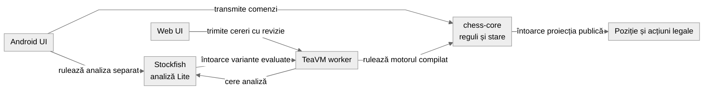
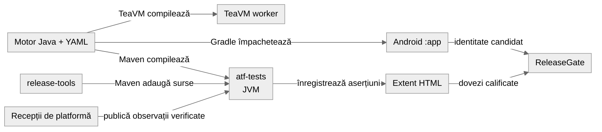
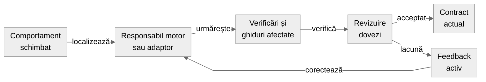

# Chess Lab

Chess Lab permite partide cu AI, probleme și studiul deschiderilor pe Android și în browser. Codul Java comun deține jocul legal și starea învățării. Analiza calculată folosește Stockfish Lite pe Web și Android; adversarul mută cu motorul Native independent. Adaptoarele prezintă jocul, iar testele și livrarea fac auditabile comportamentul și artefactele.

[Contractul analizei](docs/feedback/stockfish-web.md) guvernează indiciile, bara și Analiza partidei pe ambele platforme. Îmbunătățirea Native Hard are un [protocol A/B și Elo](docs/testing/hard-ab-elo.md) separat.

<a id="play"></a>
<a id="jocul"></a>

## Jocul

- [Descarcă APK Chess Lab 0.17.1](https://github.com/crististefanita/chess/releases/download/v0.17.1/ChessLab-0.17.1.apk)
- [Joacă în browser](https://crististefanita.github.io/chess/)

## Pe scurt

<a id="overview"></a>
<a id="pe-scurt"></a>

| Zonă | Ce oferă |
|---|---|
| Joc | Mutări legale, replici AI, partide salvate și redare. |
| Studiu | Probleme selectate, deschideri, indicii și analiza poziției. |
| Comportament comun | Reguli Java și resurse YAML compilate pentru JVM, Android și workerul Web. |
| Verificare | Aserțiuni de componentă, probe explicite de platformă, dovezi Extent și proveniența livrării. |

<a id="chess-architecture"></a>
<a id="arhitectura-j7"></a>

## Arhitectura Chess

### Reguli comune, interacțiune deținută de platformă

Android și Web transmit comenzi aceluiași contract de motor. Mutările legale, deciziile catalogului și tranzițiile partidelor salvate rămân în Java; fiecare adaptor deține interacțiunea cu ecranul, integrarea stocării locale și randarea.



<details>
<summary>Legendă — motor comun și limitele adaptoarelor</summary>

- Diagrama urmărește comenzile la execuție. Workerul Web conține motorul compilat cu TeaVM; nu apelează un JVM la distanță pentru a decide mutările legale.
- Java deține regulile, căutarea adversarului Native, interpretarea catalogului și salvările. Brokerul Web și procesul Android rulează Stockfish Lite; Java validează variantele independent de căutarea adversarului. [surse, opțiuni și verificări](web/stockfish.md).

- O aserțiune JVM sau de worker demonstrează o tranziție de stare. Pixelii nativi, layoutul browserului, accesibilitatea și restartul procesului cer proba de platformă corespunzătoare. [Atlasul arhitecturii](docs/architecture.md)

</details>

| Zonă | Deține | Ghid responsabil |
|---|---|---|
| [chess-core](chess-core/src/main) | Reguli, poziții, căutare, cataloage YAML și progres pe identități stabile. | [Tabla și învățarea](docs/board/README.md) · [Evaluarea AI](docs/board/ai-quality.md) |
| [android](android/app/src/main) | Meniuri, tablă, accesibilitate și adaptorul nativ de persistență. | [Verificări Android](docs/testing/README.md) |
| [web](web) | UI browser, stocare locală și integrarea workerului de motor. | [Build Web și paritate](web/README.md) · [Stockfish](web/stockfish.md) |
| [atf-tests](atf-tests) | Componente JVM, guvernanță și publicarea recepțiilor de platformă. | [Strategia de testare](docs/testing/README.md) |
| [release-tools](release-tools/src/main) | Selecția ghidurilor afectate, identitatea candidatului, calificare și porți de publicare. | [Proces de livrare](docs/release/README.md) |
| Dependențe | Artefacte ATF versionate, scopuri Maven și proveniență. | [Indexul local al bibliotecilor](lib/README.md) |

### Compunerea surselor și dovezile

Aceste zone nu sunt cinci module Maven. [POM-ul rădăcină](pom.xml) declară doar `atf-tests`; POM-ul său compilează motorul și adaugă sursele instrumentelor de livrare, iar Android și Web au propriile puncte de intrare pentru build.



<details>
<summary>Legendă — builduri, rapoarte și scopul acceptanței</summary>

- **Gradle** declară `:app` și include `chess-core/src/main/java` și `chess-core/src/main/resources` în buildul Android.
- **Maven** declară doar `atf-tests`, compilând `chess-core/src/main/java` și `release-tools/src/main/java` și încărcând `chess-core/src/main/resources`.
- **Biblioteci ATF** oferă `atf-reporting` și `atf-test-kit` cu scope `test`. [POM-ul testelor](atf-tests/pom.xml) · [Gradle Android](android/app/build.gradle)
- Buildul Web pregătește aceleași resurse de catalog pentru TeaVM. Paritatea workerului compară comportamentul pachetului efectiv cu așteptările JVM; este o verificare explicită, fără a fi dedusă din sursele comune.
- Extent înregistrează aserțiunile selectate și dovezile de platformă importate. Recepțiile absente, străine sau incomplete nu trebuie transformate în rezultate acceptate de dispozitiv/browser.
- `ReleaseGate` verifică identitatea candidatului și dovezile publicării. Un fișier de raport nu califică singur o livrare. [Contract de livrare](docs/release/README.md)

</details>

<a id="verification"></a>
<a id="verificare"></a>

## Verificare

Folosește JDK 21 și Maven într-o copie izolată de studiu, cu ieșiri și cache Maven proprii. Această intrare focalizată verifică reguli comune, limitele suitelor și contractul documentației; nu construiește un APK și nu exercită un browser.

```powershell
mvn -B -ntp -pl atf-tests -am test '-Dtest=ChessWebRulesComponentTest,SuiteGovernanceTest,DocumentationGovernanceTest' '-Dsurefire.failIfNoSpecifiedTests=false'
```

| Nivel | Demonstrează | Acceptanță separată |
|---|---|---|
| Componentă JVM | Reguli, tranziții de salvare, cataloage și proiecții controlate. | Randare nativă și comportament în browser. |
| Guvernanță | Limite de cod, linkuri de ghiduri, identitatea dovezilor și contracte de publicare. | Comportamentul efectiv al unui scenariu neexecutat. |
| Paritate Web și browser | Comportamentul workerului împachetat și UI observat pe profilurile selectate. | Instrumentare Android și ciclul de viață pe dispozitiv. |
| Sanity Android | Legarea Activity, interacțiune pe dispozitiv, capturi și persistență prin restart. | Calificare mai largă a livrării și forță AI măsurată. |

Jocul legal și corectitudinea analizei nu demonstrează forța de joc. Benchmarkurile cer pozițiile, bugetele și dovezile adversarului independent declarate; vezi [evaluarea AI](docs/board/ai-quality.md) și [strategia de testare](docs/testing/README.md).

### O schimbare guvernată



<details>
<summary>Legendă — selecție, dovezi și feedback concis</summary>

- RAG mapează schimbarea la ghidurile și verificările afectate. Selecția ajută alegerea dovezilor; reușita doar a etapei de selecție nu demonstrează comportamentul selectat.
- Revizuiește rezultatele componentelor și recepțiile de platformă necesare înainte de a actualiza contractul responsabil. Păstrează informațiile de implementare și comenzile aliniate cu codul live.
- Elimină elementele de feedback îndeplinite după documentarea contractului durabil acolo unde este util. Edițiile EN/RO păstrează aceleași căi, exemple și topologie a diagramelor.

</details>

<a id="published-release"></a>
<a id="ediția-publicată"></a>

## Ediția publicată

- [Chess Lab 0.17.1 · note de versiune](https://github.com/crististefanita/chess/releases/tag/v0.17.1)

## Puncte de intrare

<a id="entry-points"></a>
<a id="puncte-de-intrare"></a>

| Întrebare | Ghid responsabil |
|---|---|
| Cum se compun motorul, adaptoarele și sesiunile? | [Atlasul arhitecturii](docs/architecture.md) |
| Cum sunt definite regulile, problemele și starea învățării? | [Tabla și învățarea](docs/board/README.md) |
| Ce verificări și recepții demonstrează acceptanța? | [Strategia de testare](docs/testing/README.md) · [Build Web și paritate](web/README.md) |
| Cum sunt calificate și publicate artefactele? | [Proces de livrare](docs/release/README.md) · [Catalogul livrărilor](release/README.md) |
| Unde sunt standardele și lacunele deschise? | [Indexul documentației](docs/README.md) · [Feedback activ](docs/feedback/README.md) |
