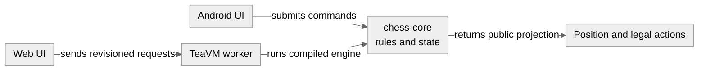
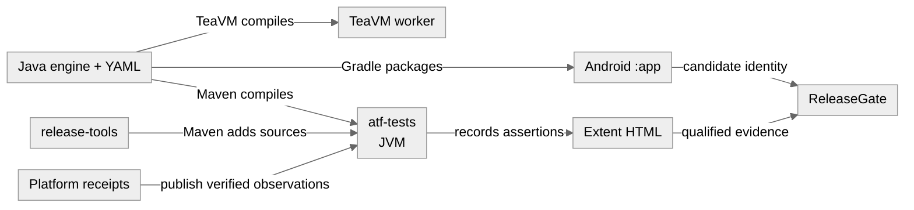
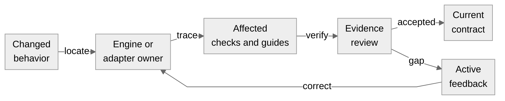

# Chess Lab

Chess Lab lets you play chess against AI, solve puzzles and study openings on Android and in the browser. A shared Java engine owns legal play, analysis and learning state; platform adapters present it, while the test and release tools make behavior and delivered artifacts auditable.

<a id="play"></a>
<a id="jocul"></a>

## Play

- [Download Chess Lab 0.16.2 APK](https://github.com/crististefanita/chess/releases/download/v0.16.2/ChessLab-0.16.2.apk)
- [Play in your browser](https://crististefanita.github.io/chess/)

## Overview

<a id="overview"></a>
<a id="pe-scurt"></a>

| Area | What it provides |
|---|---|
| Play | Legal moves, AI replies, saved games and replay. |
| Study | Curated puzzles, openings, hints and position analysis. |
| Shared behavior | Java rules and YAML resources compiled for JVM, Android and the Web worker. |
| Verification | Component assertions, explicit platform probes, Extent evidence and release provenance. |

<a id="chess-architecture"></a>
<a id="arhitectura-j7"></a>

## Chess Architecture

### Shared rules, platform-owned interaction

Android and Web submit commands to the same engine contract. Legal moves, catalog decisions and saved-game transitions stay in Java; each adapter owns screen interaction, local storage integration and rendering.



<details>
<summary>Legend — shared engine and adapter boundaries</summary>

- The diagram follows runtime commands. The Web worker contains the engine compiled with TeaVM; it does not call a remote JVM to decide legal moves.
- The engine owns rules, search, catalog interpretation and save contracts. Android preferences and browser storage integrate those contracts on their own platforms.
- A JVM or worker assertion establishes a state transition. Native pixels, browser layout, accessibility and process restart require the corresponding platform probe. [Architecture atlas](docs/architecture.md)

</details>

| Area | Owns | Owner guide |
|---|---|---|
| [chess-core](chess-core/src/main) | Rules, positions, search, YAML catalogs and progress by stable identity. | [Board and learning](docs/board/README.md) · [AI evaluation](docs/board/ai-quality.md) |
| [android](android/app/src/main) | Menus, board, accessibility and the native persistence adapter. | [Android checks](docs/testing/README.md) |
| [web](web) | Browser UI, local storage and engine-worker integration. | [Web build and parity](web/README.md) |
| [atf-tests](atf-tests) | JVM components, governance and publication of platform receipts. | [Test strategy](docs/testing/README.md) |
| [release-tools](release-tools/src/main) | Affected-guide selection, candidate identity, qualification and publication gates. | [Release process](docs/release/README.md) |
| Dependencies | Versioned ATF artifacts, Maven scopes and provenance. | [Local library index](lib/README.md) |

### Source composition and evidence

These areas are not five Maven modules. The [root POM](pom.xml) declares only `atf-tests`; its POM compiles the engine and adds the release-tool sources, while Android and Web have their own build entry points.



<details>
<summary>Legend — builds, reports and acceptance scope</summary>

- **Gradle** declares `:app` and includes `chess-core/src/main/java` and `chess-core/src/main/resources` in the Android build.
- **Maven** declares only `atf-tests`, compiling `chess-core/src/main/java` and `release-tools/src/main/java` and loading `chess-core/src/main/resources`.
- **ATF libraries** supply `atf-reporting` and `atf-test-kit` with `test` scope. [Test POM](atf-tests/pom.xml) · [Android Gradle](android/app/build.gradle)
- The Web build prepares the same catalog resources for TeaVM. Worker parity compares actual packaged behavior with JVM expectations; it is an explicit check, not an inference from source sharing.
- Extent records the selected assertions and imported platform evidence. Missing, foreign or incomplete receipts must not become accepted device/browser results.
- `ReleaseGate` checks the identified candidate and publication evidence. A report file by itself does not qualify a release. [Release contract](docs/release/README.md)

</details>

<a id="verification"></a>
<a id="verificare"></a>

## Verification

Use JDK 21 and Maven in an isolated study copy with its own outputs and Maven cache. This focused entry checks shared rules, suite boundaries and the documentation contract; it does not build an APK or exercise a browser.

```powershell
mvn -B -ntp -pl atf-tests -am test '-Dtest=ChessWebRulesComponentTest,SuiteGovernanceTest,DocumentationGovernanceTest' '-Dsurefire.failIfNoSpecifiedTests=false'
```

| Layer | Establishes | Separate acceptance |
|---|---|---|
| JVM component | Rules, save transitions, catalogs and controlled projections. | Native rendering and browser behavior. |
| Governance | Source boundaries, guide links, evidence identity and publication contracts. | The actual behavior of an unexecuted journey. |
| Web parity and browser | Packaged worker behavior and observed UI on selected profiles. | Android instrumentation and device lifecycle. |
| Android sanity | Activity wiring, device interaction, captures and persistence through restart. | Broader release qualification and measured AI strength. |

Legal play and analysis correctness do not establish playing strength. Benchmarks require their declared positions, budgets and independent opponent evidence; see [AI evaluation](docs/board/ai-quality.md) and the [test strategy](docs/testing/README.md).

### A governed change



<details>
<summary>Legend — selection, proof and concise feedback</summary>

- RAG maps a change to affected guides and checks. Selection helps choose evidence; passing only a selection step does not prove the selected behavior.
- Review component results and the required platform receipts before updating the owning contract. Keep implementation facts and commands aligned with the live code.
- Remove fulfilled feedback items after their durable contract is documented where useful. EN/RO editions keep the same paths, examples and diagram topology.

</details>

<a id="published-release"></a>
<a id="ediția-publicată"></a>

## Published Release

- [Chess Lab 0.16.2 · release notes](https://github.com/crististefanita/chess/releases/tag/v0.16.2)

## Entry Points

<a id="entry-points"></a>
<a id="puncte-de-intrare"></a>

| Question | Owner guide |
|---|---|
| How do the engine, adapters and sessions fit together? | [Architecture atlas](docs/architecture.md) |
| How are rules, puzzles and learning state defined? | [Board and learning](docs/board/README.md) |
| Which checks and receipts establish acceptance? | [Testing strategy](docs/testing/README.md) · [Web build and parity](web/README.md) |
| How are artifacts qualified and published? | [Release process](docs/release/README.md) · [Release catalog](release/README.md) |
| Where are standards and open gaps? | [Documentation index](docs/README.md) · [Active feedback](docs/feedback/README.md) |
