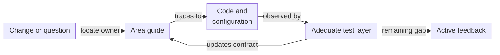

# Chess Lab Documentation

## Overview

Start with the guide that answers your question. Verify claims about behavior against the project's sources and tests.

| Question | Guide |
|---|---|
| How do the engine, app, and tests fit together? | [Chess architecture](../README.md#chess-architecture) · [Context atlas](architecture.md) · [Engine and adapters](../web/README.md#shared-engine-and-platform-adapters) · [ATF libraries](../lib/README.md) |
| How do I keep code ownership and dependencies clear? | [Code quality contract](code-quality.md) · [Owner and test map](architecture.md#owner-and-test-map) |
| How do I play and configure puzzles? | [Board and gameplay](board/README.md) · [Catalog](board/quest-curation.md) |
| How are AI opponents measured and game reviews interpreted? | [AI protocol](board/ai-quality.md#checks-for-every-change) · [Game Review](board/game-review.md) |
| What needs checking before a change? | [Choosing a test level](testing/README.md#choosing-the-test-level) · [Extent reporting](testing/README.md#extent-reporting) |
| How do I verify a feature on Web and APK? | [Web guide](../web/README.md) · [Parity matrix](../web/parity.md) |
| How is an APK qualified and where is the release evidence? | [Release process](release/README.md#qualification-and-publication) · [Published releases](../release/README.md) |
| Which assumptions still need evidence? | [Feedback](feedback/README.md) |

Ordinary Hard and puzzle-goal solvers have separate evidence: [native puzzle studies](testing/hard-puzzle-study.md).




<details>
<summary>Legend — find the owner before choosing evidence</summary>

This is a reading and maintenance map, not a build dependency graph. The owner guide connects a claim to current code and the test layer that observes it; unresolved acceptance stays in feedback. The module, architecture, testing and release links above lead to the detailed contracts.

</details>

## Maintenance Rules

- **Main README.** Purpose, APK and browser links under Play, the architecture map,
  separate edition notes, and routes to testing, releases and feedback.
- **Area guide.** Ownership, inputs, outcomes, and boundaries. Put commands next to
  their prerequisites and identify the evidence that confirms the result.
- **Format.** One title, semantic Markdown, and language tags on fenced blocks.
  Use tables for comparisons and numbered steps for procedures.
  Each diagram answers one question and has its legend immediately below.
  Use `flowchart LR`, `sequenceDiagram`, `stateDiagram-v2` or `classDiagram`, with executable content after the type. Label flow relationships with concise verbs.
- **Identity.** Use `chess` for current repository and checkout routes, and Chess Lab for the app. Preserve opaque signing/protocol identifiers and immutable historical receipts. Pin historical evidence to the commit that actually contains it; a build tag may predate the later report.
- **Language.** Review prose and visible labels in both branches against the
  [bilingual documentation contract](release/README.md#bilingual-documentation).
- **Links.** Use relative paths and existing anchors. Verify the destination after
  moving a document. Use parameters for local paths in examples.
- **Feedback.** State the observation, priority, owner, evidence, and closure criteria.
  Move each confirmed rule into its guide and remove the closed item.
- **Evidence.** Keep working builds, screenshots, and reports in TMP.
  Promoted evidence belongs in the release directory and stays tied to the binary and commit.

## Documentation Checks

Run from the TMP copy with JDK 21. If you use `-o`, the selected Maven repository
must already contain the dependencies and plugins.

```powershell
mvn -pl atf-tests -am test '-Dtest=ChessGovernanceSuite' '-Dsurefire.failIfNoSpecifiedTests=false' '-Dchess.extent=target/doc-governance.html'
```

`ChessGovernanceSuite` includes `SourceBoundaryGovernanceTest` for production
import boundaries, plus `DocumentationGovernanceTest`,
`DocumentationPairGovernanceTest`, `MarkdownDiagramGovernanceTest`,
`SuiteGovernanceTest`, `ExtentGovernanceTest`, and release governance. Together
they check README routing, local navigation, bilingual structure, Markdown,
report auditing, and publication rules.

During review, compare claims against sources and build declarations.
Check information ownership, example fidelity, rendering, and command results.
[Qualification](release/README.md#qualification-and-publication)

<details>
<summary>What the documentation guards prove</summary>

- `ProjectDocumentationIdentityTest` checks current guides and locally resolves pinned Chess evidence in the named Git objects. Keep the referenced tags/commits available; an exported tree alone cannot prove historical provenance.
- `AiDocumentationBudgetTest` compares the hint overview and ordinary-budget table with the YAML ordinary and proof-reserve limits.
- Opaque signing/protocol identifiers and immutable release receipts retain their original names.
- Prose meaning, translation fidelity and foreign external links still need review; these guards do not certify them.

</details>
