# Analysis sources and selectable lines

## Scope

Chess Lab consumes measured Stockfish 19 references in **Openings**. Runtime play, live hints and Game Review use the shared Java engine. The APK and TeaVM worker load the same reference YAML; neither runs the generator’s Stockfish executable.

| Context | Calculation owner | Meaning |
|---|---|---|
| Known opening prefix: bar and recommended continuations | Stockfish 19, recorded in [opening-reference.yaml](../../chess-core/src/main/resources/opening-reference.yaml) | Exact lesson history, depth 16, Threads 1, Hash 16 MiB, MultiPV 3; retain at most three roots within 40 cp of the best. |
| Missing opening prefix | [OpeningReference](../../chess-core/src/main/java/ro/atf/chess/OpeningReference.java) delegates to native MatchHint | One live analysis; the result carries no Stockfish reference metadata. |
| Documented theory paths | [OpeningTheory](../../chess-core/src/main/java/ro/atf/chess/OpeningTheory.java) | Up to three authored or ECO continuations in catalog order, without a claim that each is engine-best. |
| AI-game hint | [MatchHint](../../chess-core/src/main/java/ro/atf/chess/MatchHint.java) and TacticalAnalysis | Native search, independent of the opponent level; the current policy admits at most three close alternatives. |
| Intermediate and final game review | [GameReview](../../chess-core/src/main/java/ro/atf/chess/GameReview.java) and [ReviewJournal](../../chess-core/src/main/java/ro/atf/chess/ReviewJournal.java) | Native best/played comparisons persist per move; the final report aggregates complete samples and explicitly completes missing work first. |
| Board-to-board estimate inside replay | [HintPreview](../../chess-core/src/main/java/ro/atf/chess/HintPreview.java) | Native static material/position evaluation; it neither searches Stockfish nor changes the order of cached candidates. |

```mermaid
%%{init: {"themeVariables":{"fontSize":"15px"},"themeCSS":".edgeLabel, .edgeLabel p { font-size: 12px !important; } .node rect { rx: 6px; ry: 6px; }","flowchart":{"curve":"linear","nodeSpacing":24,"rankSpacing":22,"padding":6},"sequence":{"mirrorActors":false,"messageMargin":24,"wrap":true}}}%%
flowchart LR
    SF["Stockfish 19 offline"] -->|measures| YAML["Opening reference YAML"]
    YAML -->|loads exact prefix| Ref["Reference bar and lines"]
    Missing["Missing prefix"] -->|requests| Native["Java analysis"]
    Native -->|saves actual comparisons| Journal["Review journal"]
    Journal -->|aggregates| Final["Final report"]
    Ref -->|replays legal moves| Preview["Replay board"]
    Preview -->|estimates displayed boards| Static["Native static delta"]
```

Legend — measured source and runtime work

Stockfish runs during reference generation. The shared engine validates and replays its stored lines. A separate native static estimate explains the replayed boards. Native game-review evidence has its own policy and journal; it does not inherit the opening reference score.

## Score conventions

- **Reference score:** White centipawns at the recorded search horizon. **Ref. Δ** is the current exact-prefix score minus its parent-prefix score. Orientation does not change its sign.
- **Replay estimate:** static endpoint minus static starting value, from the side to move at the replay source. This is a different calculation from Ref. Δ; a black-to-move source also uses a different perspective. The two values must not be presented as the same Stockfish measurement.
- **Game Review:** native same-horizon scores become per-mille loss, grades and accuracy under [game-review.yaml](../../chess-core/src/main/resources/game-review.yaml). An eligible result can add a rating estimate. A depth-16 reference is neither a human Elo measurement nor a proof of every future defense.

## Selectable lines

The agreed interface offers **at most three selectable lines**. Two or three alternatives show their selectors; one line needs no selector row. A tab changes only the replay branch. Each branch keeps its own ply while the dialog is open, and closing returns to the unchanged source position. Native HintPreviewDialog has three stable branch IDs; reference loading rejects a fourth line before projection.

[HintSelectableLinesComponentTest](../../atf-tests/src/test/java/ro/atf/chess/HintSelectableLinesComponentTest.java) checks real catalog frames, one/two/three-line fixtures and the fourth-line negative. The Web DOM component cases exercise every selector in RO/EN, preserved cursors, Back/Next and one completed analysis request. These components do not certify pixel rendering.

## Evidence and updates

Reference generation records the exact Stockfish binary digest and fixed settings. Retain the prefix input and raw UCI transcript outside the checkout; regenerate after changing the lesson paths and run the [component selection](../testing/README.md#analysis-reuse-components). [Generation contract](openings.md#measured-opening-references)

Keep reference metadata separate from native static replay estimates and native review-work identity. Only complete comparisons enter the journal; policy/version mismatches trigger explicit missing-work recovery. [Persistence contract](game-review.md#persistent-per-move-work)
