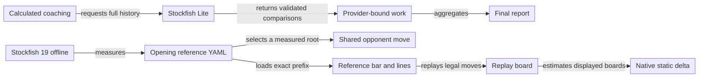

# Analysis sources and selectable lines

## Required coaching contract

The requested destination is **Stockfish Lite** for every calculated hint, evaluation bar, comparison and interim/final review, on Android, hosted Web and localhost. This applies in AI games, the manual board and openings. Opponent difficulty cannot weaken or replace the coaching provider. No missing result may silently select Native analysis. [Route matrix, incomplete work and delivery owner](../feedback/stockfish-web.md)

The following table describes the Lite candidate and the separate stored-reference paths. Catalog solutions and deterministic rule checking retain their provenance; any calculated explanatory coaching line still belongs to Stockfish. A longer PV is not a completed depth, an exhaustive proof or an Elo gain. [Measurement protocol](../testing/hard-ab-elo.md)

## Scope

Chess Lab consumes measured Stockfish 19 references in **Openings**. The APK and TeaVM worker share Java rules, catalogs and storage contracts. Web hints, opening analysis, the manual board and new Game Reviews use the local Stockfish WebAssembly engine. Android uses the local Lite transport for the same calculated coaching surfaces; platform acceptance remains separately reported. The generator's executable and stored reference YAML remain a separate source. [Current implementation and Android acceptance](../feedback/stockfish-web.md) · [Web provider and validation](../../web/stockfish.md)

| Context | Calculation owner | Meaning |
|---|---|---|
| Known opening prefix: bar and recommended continuations | Stockfish 19, recorded in [opening-reference.yaml](../../chess-core/src/main/resources/opening-reference.yaml) | Exact lesson history, depth 16, Threads 1, Hash 16 MiB, MultiPV 3; retain at most three roots within 40 cp of the best. |
| Opponent move at a covered opening prefix | The same stored Stockfish 19 roots, selected by the shared Java [OpeningRepertoire](../../chess-core/src/main/java/ro/atf/chess/OpeningRepertoire.java) | A saved per-game ordinal rotates pseudo-randomly among the measured roots. Exact history must match; verified repertoire overrides stay authoritative and uncovered positions use the existing curated theory/search behavior. No live engine call is added to opponent moves. |
| Calculated opening coaching on Android | [StockfishCoaching](../../chess-core/src/main/java/ro/atf/chess/StockfishCoaching.java) with the full lesson history | Stockfish Lite supplies the displayed bar and recommendations. Missing stored data cannot select Native coaching. |
| Web opening and manual-board analysis | [Local Stockfish engine](../../web/stockfish.md) with the Java context validator | A live source-bound search; its depth, WDL and PVs are separate from stored opening references. |
| Documented theory paths | [OpeningTheory](../../chess-core/src/main/java/ro/atf/chess/OpeningTheory.java) | Up to three authored or ECO continuations in catalog order, without a claim that each is engine-best. |
| AI-game and manual-board hint | [MatchHint](../../chess-core/src/main/java/ro/atf/chess/MatchHint.java) validates the provider result | Web and Android use their pinned Stockfish Lite transports. Opponent difficulty never weakens the coaching engine. Only close alternatives are offered. |
| Intermediate and final game review | [GameReview](../../chess-core/src/main/java/ro/atf/chess/GameReview.java) validates best/played comparisons | Native [ReviewJournal](../../chess-core/src/main/java/ro/atf/chess/ReviewJournal.java) is distinct from external Stockfish evidence. Android migration must preserve provider-bound journals; aggregation requires complete same-provider samples. |
| Board-to-board estimate inside legacy replay | [HintPreview](../../chess-core/src/main/java/ro/atf/chess/HintPreview.java) | A static material/position delta is not a Stockfish measurement. If retained as an auxiliary value, it must be labelled separately and never substitute for the provider's evaluation or add an unscored PV suffix. |

Legend — calculated coaching and catalog knowledge

The diagram describes calculated coaching separately from catalog knowledge. Web runs its pinned engine locally on demand; the Android Stockfish adapter is validated against its own executable and data pins. Java validates legal replay for both transports. Stored references keep their original measured depth and source; they are not relabelled as new live searches. Native proof-based catalog checking is independent of the coaching provider.

## Score conventions

- **Vertical advantage bar:** the shared Java `MatchEvaluation.whiteShare()` maps the measured White score `cp` to `0.5 + 0.5 × cp / (400 + |cp|)`. Equal play stays at 50%; +1, +3 and +8 pawns occupy about 60%, 71% and 83%. Every finite centipawn score leaves the other segment visible. Mate estimates and final results retain their endpoints; draws stay centered. Web and Android use the same projection in games, openings and the analysis board. Orientation only reverses the track direction. This display scale is not WDL or a calibrated probability; raw CP, mate distance, WDL, legal PV and provider evidence remain intact for review and grading. [Executable scale and adapter contracts](../../atf-tests/src/test/java/ro/atf/chess/EvaluationBarScaleTest.java)

- **Reference score:** White centipawns at the recorded search horizon. **Ref. Δ** is the current exact-prefix score minus its parent-prefix score. Orientation does not change its sign.
- **Replay estimate:** static endpoint minus static starting value, from the side to move at the replay source. This is a different calculation from Ref. Δ; a black-to-move source also uses a different perspective. The two values must not be presented as the same Stockfish measurement.
- **Game Review:** legacy native same-horizon scores become per-mille loss, grades and accuracy under [game-review.yaml](../../chess-core/src/main/resources/game-review.yaml). External reviews retain Stockfish WDL at a common completed depth; the same contract is required for the Android migration. An eligible result can add a rating estimate under its existing opponent policy; changing the analyzer does not recalibrate an opponent.
- **Search evidence:** PV length, completed depth and selective depth are different quantities. Record actual nodes/time and the requested cap separately. A depth-16 reference or a longer PV is neither a human Elo measurement nor a proof of every future defense; free/played comparisons require the same context, provider and completed horizon.

## Selectable lines

The agreed interface offers **at most three selectable lines**. Two or three alternatives show their selectors; one line needs no selector row. Web accepts only a complete exact MultiPV batch at one finished depth; if a deeper search is interrupted partway through, it retains the latest complete batch. It never combines ranks across depths. Close alternatives are filtered after that batch is selected, so the interface shows three when three meet the thresholds and fewer when the others are materially worse. When shown, all selectors stay in one row and share the available width; long labels truncate visually while retaining their full accessible name and a 48 CSS px Web or 48 dp native target height. A tab changes only the replay branch. Each branch keeps its own ply while the dialog is open, and closing returns to the unchanged source position. Native HintPreviewDialog has three stable branch IDs; reference loading rejects a fourth line before projection.

[HintSelectableLinesComponentTest](../../atf-tests/src/test/java/ro/atf/chess/HintSelectableLinesComponentTest.java) checks real catalog frames, one/two/three-line fixtures and the fourth-line negative. The Web DOM component cases exercise every selector in RO/EN, preserved cursors, Back/Next and one completed analysis request. These components do not certify pixel rendering.

## Evidence and updates

Reference generation records the exact Stockfish binary digest and fixed settings. Retain the prefix input and raw UCI transcript outside the checkout; regenerate after changing the lesson paths and run the [component selection](../testing/README.md#analysis-reuse-components). [Generation contract](openings.md#measured-opening-references)

Keep reference metadata separate from native static replay estimates and native review-work identity. Only complete comparisons enter the journal; policy/version mismatches trigger explicit missing-work recovery. [Persistence contract](game-review.md#persistent-per-move-work)
