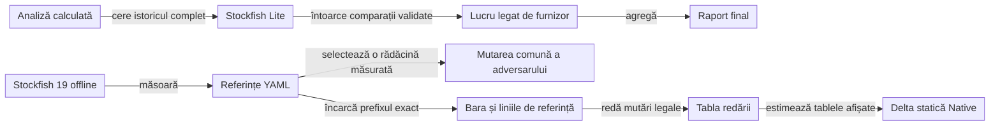

# Sursele analizei și liniile selectabile

## Contractul analizei cerute

Destinația cerută este **Stockfish Lite** pentru fiecare indiciu calculat, bară, comparație și analiză intermediară/finală pe Android, Web găzduit și localhost. Se aplică partidelor AI, tablei de analiză și deschiderilor. Nivelul adversarului nu poate slăbi sau înlocui furnizorul analizei. Lipsa unui rezultat nu poate selecta implicit Native. [Matrice, lucru incomplet și responsabilul livrării](../feedback/stockfish-web.md)

Tabelul descrie candidatul Lite și rutele distincte ale referințelor memorate. Soluțiile catalogului și verificarea deterministă păstrează proveniența; orice explicație calculată aparține Stockfish. O PV mai lungă nu este adâncime încheiată, dovadă exhaustivă sau câștig Elo. [Protocolul de măsurare](../testing/hard-ab-elo.md)

## Domeniu

Chess Lab consumă referințe Stockfish 19 măsurate în **Deschideri**. APK și TeaVM împart reguli Java, catalog și contracte de stocare. Indiciile Web, analiza deschiderilor, tabla manuală și review-urile noi folosesc motorul WebAssembly local. Android folosește transportul Lite local pentru aceleași calcule; acceptarea platformei se raportează separat. Executabilul generatorului și YAML-ul de referință rămân o sursă distinctă. [Implementare și acceptare Android](../feedback/stockfish-web.md) · [Furnizor și validare Web](../../web/stockfish.md)

| Context | Cine calculează | Semnificație |
|---|---|---|
| Prefix cunoscut: bară și continuări recomandate | Stockfish 19, în [opening-reference.yaml](../../chess-core/src/main/resources/opening-reference.yaml) | Istoric exact, depth 16, Threads 1, Hash 16 MiB, MultiPV 3; cel mult trei rădăcini la maximum 40 cp de lider. |
| Mutarea adversarului la prefix acoperit | Aceleași rădăcini Stockfish 19 memorate, selectate de [OpeningRepertoire](../../chess-core/src/main/java/ro/atf/chess/OpeningRepertoire.java) comun | Ordinalul salvat rotește opțiunile pseudoaleator. Istoricul trebuie să coincidă; suprascrierile verificate au prioritate, iar pozițiile neacoperite păstrează teoria/căutarea existentă. Fără apel live al motorului pentru adversar. |
| Analiza calculată a deschiderii Android | [StockfishCoaching](../../chess-core/src/main/java/ro/atf/chess/StockfishCoaching.java) cu istoricul lecției | Lite furnizează bara și recomandările. Datele memorate lipsă nu pot selecta Native. |
| Analiza Web a deschiderii și tablei manuale | [Motorul Stockfish local](../../web/stockfish.md) cu validatorul contextului Java | Căutare live legată de sursă; adâncimea, WDL și PV sunt distincte de referințele memorate. |
| Căi teoretice documentate | [OpeningTheory](../../chess-core/src/main/java/ro/atf/chess/OpeningTheory.java) | Până la trei continuări redactate sau ECO, fără a pretinde că fiecare este cea mai bună a motorului. |
| Indiciu AI și tabla manuală | [MatchHint](../../chess-core/src/main/java/ro/atf/chess/MatchHint.java) validează rezultatul furnizorului | Web și Android folosesc transporturile Lite fixate. Nivelul adversarului nu slăbește analiza. Sunt oferite doar alternative apropiate. |
| Analiza intermediară și finală | [GameReview](../../chess-core/src/main/java/ro/atf/chess/GameReview.java) validează comparațiile | [ReviewJournal](../../chess-core/src/main/java/ro/atf/chess/ReviewJournal.java) Native este distinct de dovezile externe. Migrarea Android păstrează identitatea furnizorului; agregarea cere date complete din aceeași sursă. |
| Estimarea dintre table în redarea veche | [HintPreview](../../chess-core/src/main/java/ro/atf/chess/HintPreview.java) | Delta statică nu este măsurare Stockfish. Dacă este păstrată auxiliar, trebuie etichetată distinct și nu poate înlocui evaluarea sau adăuga un sufix PV fără scor. |

Legendă — analiză calculată și cunoașterea catalogului

Diagrama separă analiza calculată de catalog. Web rulează local motorul fixat la cerere; adaptorul Android este validat față de propriii pini ai executabilului și datelor. Java validează redarea legală pentru ambele transporturi. Referințele memorate păstrează adâncimea și sursa inițială, fără a fi redenumite căutări noi. Verificarea Native a catalogului pe bază de dovezi este independentă de furnizorul analizei.

## Convențiile scorurilor

- **Scorul referinței:** centipioni pentru Alb la orizontul măsurat. **Ref. Δ** este scorul prefixului curent minus cel al părintelui. Orientarea nu schimbă semnul.
- **Estimarea redării:** diferență statică final–inițial din perspectiva culorii la mutare în sursa redării. Diferă de Ref. Δ; sursa cu Negrul la mutare folosește altă perspectivă. Nu pot fi prezentate drept aceeași măsurare Stockfish.
- **Analiza partidei:** scorurile Native vechi la orizont egal devin pierdere în miimi, categorii și precizie conform [game-review.yaml](../../chess-core/src/main/resources/game-review.yaml). Review-urile externe păstrează WDL Stockfish la adâncime comună; același contract se aplică migrării Android. O partidă eligibilă poate adăuga estimarea ratingului potrivit politicii adversarului; schimbarea analizei nu recalibrează adversarul.
- **Dovada căutării:** lungimea PV, adâncimea încheiată și cea selectivă sunt diferite. Se înregistrează separat nodurile/timpul efectiv și plafonul cerut. Referința la depth 16 sau PV mai lungă nu măsoară Elo uman ori toate apărările viitoare; comparațiile liber/jucat cer același context, furnizor și orizont încheiat.

## Linii selectabile

Interfața agreată oferă **cel mult trei linii selectabile**. Două sau trei alternative arată selectoarele; una singură nu cere rând de selectoare. Web acceptă doar lot MultiPV exact complet la aceeași adâncime; întreruperea unei căutări mai adânci păstrează ultimul lot complet. Nu combină ranguri de la adâncimi diferite. Filtrarea apropierii se face după alegerea lotului, astfel încât apar trei când trei respectă pragurile și mai puține când celelalte sunt mult mai slabe. Selectoarele împart un rând și lățimea disponibilă; etichetele lungi sunt scurtate vizual, păstrând numele accesibil complet și țintele de 48 CSS px Web sau 48 dp native. Tabul schimbă numai ramura. Fiecare ramură păstrează cursorul în dialog; închiderea revine la sursa neschimbată. HintPreviewDialog are trei ID-uri stabile de ramură; încărcarea referinței respinge a patra linie înainte de proiecție.

[HintSelectableLinesComponentTest](../../atf-tests/src/test/java/ro/atf/chess/HintSelectableLinesComponentTest.java) verifică pozițiile catalogului, redarea cu una/două/trei linii și negativul celei de-a patra. Componentele DOM Web verifică fiecare selector în RO/EN, cursoare, Înapoi/Înainte și o cerere de analiză încheiată. Nu certifică randarea pixelilor.

## Dovezi și actualizări

Generarea referinței consemnează digestul binarului Stockfish și setările fixe. Păstrați prefixul și UCI brut în afara checkout-ului; regenerați după schimbarea lecțiilor și rulați [selecția componentelor](../testing/README.md#componente-pentru-reutilizarea-analizei). [Contractul generării](openings.md#referințe-măsurate-ale-deschiderilor)

Păstrați metadatele referinței separat de estimări statice și identitatea lucrului Native pentru review. Doar comparațiile complete intră în jurnal; nepotrivirile de politică/versiune declanșează recuperarea explicită a lipsurilor. [Contractul persistenței](game-review.md#lucru-persistent-pe-mutare)