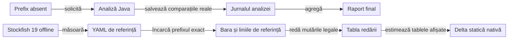

# Sursele analizei și liniile selectabile

## Domeniu

Chess Lab folosește referințe măsurate cu Stockfish 19 în **Deschideri**. Jocul, indiciile live și Analiza partidei folosesc motorul Java comun. APK-ul și workerul TeaVM încarcă același YAML; niciunul nu rulează executabilul Stockfish folosit de generator.

| Context | Cine calculează | Semnificație |
|---|---|---|
| Prefix cunoscut de deschidere: bară și continuări recomandate | Stockfish 19, consemnat în [opening-reference.yaml](../../chess-core/src/main/resources/opening-reference.yaml) | Istoricul exact al lecției, depth 16, Threads 1, Hash 16 MiB, MultiPV 3; cel mult trei mutări la maximum 40 cp de lider. |
| Prefix de deschidere absent | [OpeningReference](../../chess-core/src/main/java/ro/atf/chess/OpeningReference.java) deleagă către MatchHint nativ | O singură analiză live; rezultatul nu poartă metadate de referință Stockfish. |
| Trasee documentate de teorie | [OpeningTheory](../../chess-core/src/main/java/ro/atf/chess/OpeningTheory.java) | Cel mult trei continuări din lecții sau ECO, în ordinea catalogului, fără a pretinde că fiecare este cea mai bună a motorului. |
| Indiciu în partida cu AI | [MatchHint](../../chess-core/src/main/java/ro/atf/chess/MatchHint.java) și TacticalAnalysis | Căutare nativă, independentă de nivelul adversarului; politica actuală admite cel mult trei alternative apropiate. |
| Analiza intermediară și finală a partidei | [GameReview](../../chess-core/src/main/java/ro/atf/chess/GameReview.java) și [ReviewJournal](../../chess-core/src/main/java/ro/atf/chess/ReviewJournal.java) | Comparațiile native recomandat/jucat se salvează pe mutare; raportul final agregă datele complete și completează explicit lipsurile înainte. |
| Estimarea dintre tablele redării | [HintPreview](../../chess-core/src/main/java/ro/atf/chess/HintPreview.java) | Evaluare statică nativă de material/poziție; nu caută cu Stockfish și nu schimbă ordinea candidaților memorați. |

Legendă — sursa măsurată și calculul din aplicație

Stockfish rulează la generarea referințelor. Motorul comun validează și redă liniile memorate. O estimare statică nativă separată explică tablele redării. Dovezile analizei partidei au propria politică și propriul jurnal; nu moștenesc scorul de referință al deschiderii.

## Convențiile scorurilor

- **Scor de referință:** centipioni din perspectiva albului la orizontul măsurat. **Ref. Δ** este scorul prefixului exact curent minus scorul prefixului părinte. Orientarea nu îi schimbă semnul.
- **Estimarea redării:** valoarea statică finală minus cea inițială, din perspectiva culorii aflate la mutare în sursa redării. Este un calcul diferit de Ref. Δ; o sursă cu negrul la mutare folosește și altă perspectivă. Cele două valori nu trebuie prezentate drept aceeași măsurătoare Stockfish.
- **Analiza partidei:** scorurile native la orizont comun devin pierdere în miimi, categorii și precizie conform [game-review.yaml](../../chess-core/src/main/resources/game-review.yaml). Rezultatul eligibil poate adăuga o estimare de rating. O referință la depth 16 nu măsoară Elo uman și nu dovedește toate apărările viitoare.

## Linii selectabile

Interfața agreată oferă **cel mult trei linii selectabile**. Două sau trei alternative afișează selectoarele; o singură linie nu are nevoie de rând de selecție. Când apar, toate selectoarele rămân pe un rând și împart lățimea disponibilă; etichetele lungi se trunchiază vizual, păstrând numele accesibil complet și o țintă de 48 CSS px pe Web sau 48 dp nativ. Un tab schimbă doar ramura redării. Fiecare ramură își păstrează semimutarea cât dialogul este deschis, iar închiderea revine la sursa neschimbată. HintPreviewDialog nativ are trei ID-uri stabile; încărcarea referinței respinge a patra linie înainte de proiectare.

[HintSelectableLinesComponentTest](../../atf-tests/src/test/java/ro/atf/chess/HintSelectableLinesComponentTest.java) verifică toate cadrele reale, cazuri cu una/două/trei linii și refuzul celei de-a patra. Componentele DOM Web apasă fiecare selector în RO/EN și verifică păstrarea cursorilor, Înapoi/Înainte și o singură cerere de analiză completă. Aceste componente nu certifică randarea în pixeli.

## Dovezi și actualizări

Generarea referinței consemnează amprenta exactă a binarului Stockfish și setările fixe. Păstrează intrările și transcriptul UCI brut în afara checkout-ului; regenerează după modificarea traseelor lecțiilor și rulează [selecția de componente](../testing/README.md#componente-pentru-reutilizarea-analizei). [Contractul generării](openings.md#referințe-măsurate-pentru-deschideri)

Separă metadatele referinței de estimările statice native și identitatea jurnalului de analiză. În jurnal intră doar comparațiile complete; politica sau versiunea nepotrivită declanșează completarea explicită a lucrului lipsă. [Contractul persistenței](game-review.md#lucru-persistent-pe-fiecare-mutare)
