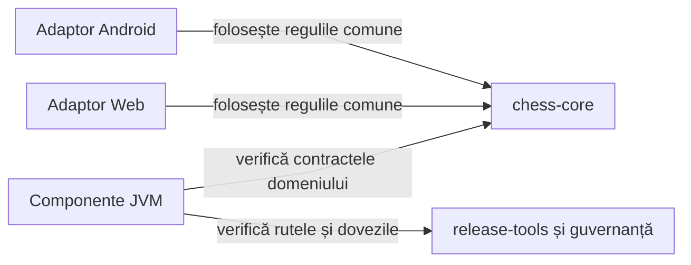

# Contractul de calitate a codului

Folosiți ghidul împreună cu [atlasul arhitecturii](architecture.md) pentru a
stabili ownerul unei schimbări, apoi alegeți dovezile din [strategia de
testare](testing/README.md). Documentul înregistrează limitele Chess și
întrebările de revizie; nu impune praguri de număr de clase sau linii.

## Proprietatea și direcția dependențelor



<details>
<summary>Legendă — proprietarii runtime-ului și limita verificării</summary>

- `chess-core` deține regulile de șah, starea partidei, proiecțiile comune și
  politicile pure folosite de ambii clienți.
- Android deține view-urile Android, preferințele, ciclul de viață și adaptoarele
  de accesibilitate. Web deține prezentarea browserului, stocarea și mesajele
  workerului.
- `release-tools` deține dovezile release-ului și rutele consultative. Nu face
  parte din comportamentul jocului.
- `atf-tests` deține verificările de componentă și guvernanță. ATF Reporting și
  Test Kit rămân dependențe cu scope de test.
- Săgețile arată direcția dependențelor, nu afirmă că adaptoarele partajează
  codul de randare.

</details>

Atlasul arhitecturii rămâne ownerul inventarului complet de module și al
topologiei build-ului. Acest ghid deține doar regulile de revizie de mai jos.

## Revizia schimbării

- Păstrați deciziile de domeniu în `chess-core`; păstrați efectele sistemului de
  operare, browserului, stocării, randării și ciclului de viață în adaptoarele
  platformei.
- Partajați o regulă prin core numai când Android și Web pot folosi același
  comportament fără să importe API-urile vreunei platforme.
- Atribuiți fiecărei tranziții de stare un singur owner. Adaptoarele traduc
  intrarea și prezintă rezultatul; nu reimplementează tacit regulile jocului sau
  politica de persistență.
- Preferați starea tipizată și rezultate explicite la boundary-uri. Un fallback
  nu trebuie să transforme dovezile lipsă, expirate sau incomplete într-un
  rezultat reușit.
- Extrageți o abstracție când elimină o politică duplicată sau izolează o limită
  reală. Nu împărțiți clase și nu adăugați module doar pentru a respecta un prag
  de dimensiune.
- Adăugați cel mai mic test de componentă care observă contractul schimbat.
  Păstrați sanity-ul nativ sau de browser doar pentru comportamentul platformei
  pe care o componentă nu îl poate observa. [Alegerea nivelului de testare](testing/README.md#alegerea-nivelului)

## Guvernanță executabilă

| Contract | Guard | Ce nu demonstrează |
|---|---|---|
| Importurile surselor de producție respectă limitele platformelor | `SourceBoundaryGovernanceTest` | Reflecție, bytecode generat și comportament runtime |
| Arhitectura din README corespunde declarațiilor Maven și Gradle | `DocumentationGovernanceTest` | Dacă proza explică fiecare clasă |
| Linkurile, ancorele, Markdown-ul și diagramele rămân navigabile | `DocumentationGovernanceTest`, `MarkdownDiagramGovernanceTest` | Sensul traducerii sau pixelii randării Android/Web |
| Fiecare test JVM aparține unei singure suite primare și are audit Extent | `SuiteGovernanceTest`, `ExtentGovernanceTest` | Randarea nativă sau în browser |
| Documentele în engleză și română păstrează inventarul și structura pereche | `DocumentationPairGovernanceTest` | Echivalența semantică a prozei și exemplelor reformulate |

Rulați suita de guvernanță a proiectului dintr-o copie curată în TMP:

```powershell
mvn -pl atf-tests -am test '-Dtest=ChessGovernanceSuite' '-Dsurefire.failIfNoSpecifiedTests=false' '-Dchess.extent=target/engineering-governance.html'
```

Guard-ul importurilor scanează fișierele `src/main/java` curente și are fixture-uri
negative pentru importurile interzise. Este intenționat restrâns: declarațiile
build-ului rămân verificate de `DocumentationGovernanceTest`, iar compilarea și
comportamentul runtime rămân responsabilitatea verificărilor de componentă și
platformă.

## Responsabilitatea feedback-ului

Înregistrați o lacună de calitate confirmată și nerezolvată în [registrul de
feedback](feedback/README.md), cu owner, dovezi și criteriu de închidere. După ce
o regulă stabilă este acoperită de acest ghid și guard-ul său, eliminați punctul
închis din feedback în loc să păstrați o a doua copie normativă. Păstrați lucrul
despre forța jocului și calitatea căutării în documentele owner ale AI-ului; acest
ghid nu schimbă algoritmii sau pragurile respective.
