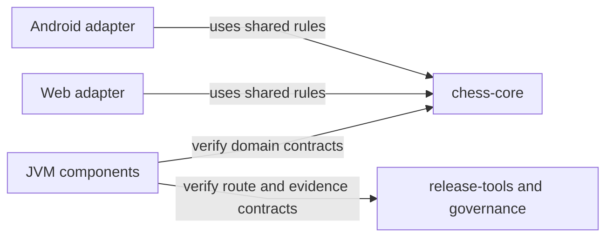

# Code quality contract

Use this guide with the [architecture atlas](architecture.md) to place a change
at its owner, then choose evidence from the [testing strategy](testing/README.md).
It records Chess-specific boundaries and review questions; it does not prescribe
class-count or line-count targets.

## Ownership and dependency direction



<details>
<summary>Legend — runtime owners and verification boundary</summary>

- `chess-core` owns chess rules, game state, shared projections, and the pure
  policies consumed by both clients.
- Android owns Android views, preferences, lifecycle, and accessibility
  adapters. Web owns browser presentation, storage, and worker messaging.
- `release-tools` owns release evidence and advisory routes. It is not part of
  game behavior.
- `atf-tests` owns component and governance checks. ATF Reporting and Test Kit
  remain test-scoped dependencies.
- The arrows describe dependency direction, not a claim that the adapters share
  rendering code.

</details>

The architecture atlas remains the owner of the full module inventory and build
topology. This guide owns only the change-review rules below.

## Change review

- Keep domain decisions in `chess-core`; keep operating-system, browser, storage,
  rendering, and lifecycle effects in their platform adapters.
- Share a rule through the core only when Android and Web can consume the same
  behavior without importing either platform's APIs.
- Give a state transition one owner. Adapters translate input and present
  results; they must not silently reimplement game rules or persistence policy.
- Prefer typed state and explicit outcomes at boundaries. A fallback must not
  turn missing, stale, or incomplete evidence into a successful result.
- Extract an abstraction when it removes duplicated policy or isolates a real
  boundary. Do not split classes or add a module only to satisfy a size target.
- Add the smallest component test that can observe the changed contract. Keep
  native or browser sanity only for platform behavior that a component cannot
  observe. [Test-level selection](testing/README.md#choosing-the-test-level)

## Executable governance

| Contract | Guard | What it does not prove |
|---|---|---|
| Production imports follow the platform boundary | `SourceBoundaryGovernanceTest` | Reflection, generated bytecode, and runtime behavior |
| README architecture matches Maven and Gradle source declarations | `DocumentationGovernanceTest` | Whether the prose explains every class |
| Links, anchors, Markdown, and diagrams remain navigable | `DocumentationGovernanceTest`, `MarkdownDiagramGovernanceTest` | Translation meaning or rendered Android/Web pixels |
| Each JVM test has one primary suite and an Extent audit | `SuiteGovernanceTest`, `ExtentGovernanceTest` | Native or browser rendering |
| English and Romanian documents keep paired inventory and structure | `DocumentationPairGovernanceTest` | Semantic equivalence of rewritten prose and examples |

Run the project governance suite from a clean TMP source copy:

```powershell
mvn -pl atf-tests -am test '-Dtest=ChessGovernanceSuite' '-Dsurefire.failIfNoSpecifiedTests=false' '-Dchess.extent=target/engineering-governance.html'
```

The import guard scans current `src/main/java` files and has negative fixtures
for forbidden imports. It is deliberately small: build declarations remain
checked by `DocumentationGovernanceTest`, and compile/runtime behavior remains
the responsibility of the component and platform checks.

## Feedback ownership

Put a confirmed, unresolved quality gap in the [feedback register](feedback/README.md)
with its owner, evidence, and closure criterion. Once a stable rule is covered by
this guide and its guard, remove the closed feedback item instead of retaining a
second normative copy. Keep game-strength and search-quality work in the AI
owner documents; this guide does not change those algorithms or their thresholds.
