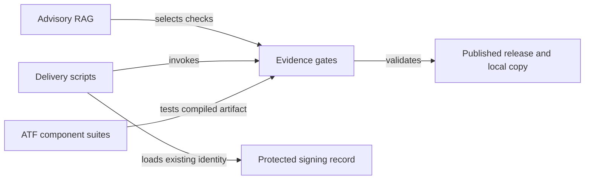

# Chess release tools

## Overview

An independent JVM module for planning, qualifying and delivering Chess releases. It produces `chess-release-tools`; Android and the Web game do not consume this JAR. [Release procedure](../docs/release/README.md)

## Responsibilities

| Area | Owns |
|---|---|
| `src/main/java` | Advisory RAG, immutable Git review, evidence gates and local release synchronization. |
| `scripts` | Signing, signer continuity, authenticated download and local delivery adapters. |
| [`.atf-signing`](.atf-signing/README.md) | The existing protected identity, public certificate and relative manifest. |
| [ATF components](../atf-tests/src/test/java/ro/atf/chess/ReleaseModuleLayoutTest.java) | Module boundaries, relocated paths, recovery negatives and execution through the compiled dependency. |

The module depends only on pinned SnakeYAML. `atf-tests` consumes its artifact through Maven; the old source merger is removed. Integration tests remain in the existing ATF suites so each run has one auditable Extent publisher. Signing files and delivery scripts are outside the JAR's resources.

Git pipe readers and the input writer use independent daemon threads. Components verify a large input and repeated binary batches with one virtual-thread carrier; the existing 20-second process deadline is unchanged. This prevents a blocked stream reader from starving the writer on a small JVM.



<details>
<summary>Legend — authority and ownership</summary>

RAG cites guidance and selects checks. Gates admit verified evidence; scripts perform explicit delivery steps. The signing identity is loaded unchanged. Test integration supplies original Extent assertions without making the production JAR depend on the game or ATF reporting.

</details>

## Build and commands

Build in an external worktree under `C:\work\sah`, with its own Maven repository. `package` produces the thin JAR and its pinned runtime dependency in `target/lib`; the JAR manifest identifies `ReleaseGate` and that relative dependency.

```powershell
mvn -pl release-tools -am package
java -jar release-tools/target/chess-release-tools-0.17.1-SNAPSHOT.jar links README.md
java -cp release-tools/target/chess-release-tools-0.17.1-SNAPSHOT.jar ro.atf.chess.release.ReleaseRag release-tools pom.xml
```

The PowerShell adapters resolve the checkout from layout markers rather than the current directory or a fixed parent count. They can use the compiled module and `target/lib` automatically; an explicit classpath remains supported. Run the ATF components from the root with `-pl atf-tests -am`. [Suite selection](../docs/testing/README.md#jvm-suites)

## Identity and migration

The record moved from the repository root into this module without changing the encrypted key, DPAPI envelope, certificate or relative manifest. Do not create another identity to repair a path. The initializer rejects partial records and a remaining legacy root record before loading credentials; missing published keys still require explicit recovery.

Signing logs and generated certificates use an external `-WorkRoot`; downloads require a fresh external directory. Published APKs and original evidence stay in the [release area](../release/README.md). This source-layout refactoring does not rebuild or requalify the unchanged game APK.
