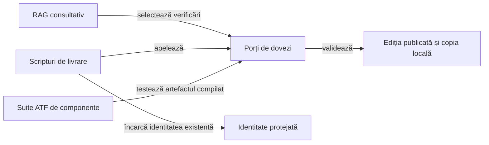

# Instrumentele de release Chess

## Pe scurt

Modul JVM independent pentru planificarea, calificarea și livrarea edițiilor Chess. Produce `chess-release-tools`; Android și jocul Web nu consumă acest JAR. [Procesul de release](../docs/release/README.md)

## Responsabilități

| Zonă | Deține |
|---|---|
| `src/main/java` | RAG consultativ, revizuire Git imuabilă, porți de dovezi și sincronizarea release-ului local. |
| `scripts` | Adaptoare pentru semnare, continuitatea certificatului, download autentificat și livrare locală. |
| [`.atf-signing`](.atf-signing/README.md) | Identitatea protejată existentă, certificatul public și manifestul relativ. |
| [Componentele ATF](../atf-tests/src/test/java/ro/atf/chess/ReleaseModuleLayoutTest.java) | Granițele modulului, căile mutate, cazurile negative de recuperare și execuția prin dependența compilată. |

Modulul depinde doar de SnakeYAML fixat. `atf-tests` consumă artefactul prin Maven; vechea includere directă a surselor este eliminată. Testele de integrare rămân în suitele ATF existente, cu un singur publicator Extent auditabil per execuție. Fișierele de semnare și scripturile de livrare sunt în afara resurselor JAR-ului.

Cititoarele pipe-urilor Git și scriitorul intrării folosesc fire daemon independente. Componentele verifică intrare mare și loturi binare repetate cu un singur fir purtător pentru fire virtuale; termenul existent de 20 de secunde pentru proces rămâne neschimbat. Astfel citirea blocată nu poate împiedica pornirea scriitorului pe un JVM mic.



<details>
<summary>Legendă — autoritate și responsabilități</summary>

RAG citează ghidurile și selectează verificările. Porțile admit dovezi verificate; scripturile execută pașii expliciți de livrare. Identitatea de semnare este încărcată neschimbată. Integrarea testelor oferă aserțiuni Extent originale fără ca JAR-ul de producție să depindă de joc sau de raportarea ATF.

</details>

## Build și comenzi

Construiește într-un worktree extern sub `C:\work\sah`, cu propriul repository Maven. `package` produce JAR-ul simplu și dependența runtime fixată în `target/lib`; manifestul JAR identifică `ReleaseGate` și acea dependență relativă.

```powershell
mvn -pl release-tools -am package
$version = ([xml](Get-Content -Raw pom.xml)).project.version
$releaseJar = "release-tools/target/chess-release-tools-$version.jar"
java -jar $releaseJar links README.md
java -cp $releaseJar ro.atf.chess.release.ReleaseRag release-tools pom.xml
```

Adaptoarele PowerShell rezolvă checkout-ul după markerii structurii, independent de directorul curent sau un număr fix de părinți. Pot folosi automat modulul compilat și `target/lib`; classpath-ul explicit rămâne acceptat. Rulează componentele ATF din rădăcină cu `-pl atf-tests -am`. [Selectarea suitei](../docs/testing/README.md#suite-jvm)

## Identitate și migrare

Identitatea s-a mutat din rădăcina repository-ului în acest modul fără schimbarea cheii criptate, a anvelopei DPAPI, a certificatului sau a manifestului relativ. Nu crea altă identitate pentru a repara o cale. Inițializatorul respinge înregistrările parțiale și un director vechi rămas în rădăcină înaintea încărcării credențialelor; cheia publicată lipsă cere în continuare recuperare explicită.

Logurile semnării și certificatele generate folosesc un `-WorkRoot` extern; downloadul cere un director extern nou. APK-urile publicate și dovezile originale rămân în [zona de release](../release/README.md). Această refactorizare a structurii surselor nu reconstruiește și nu recalifică APK-ul jocului neschimbat.
