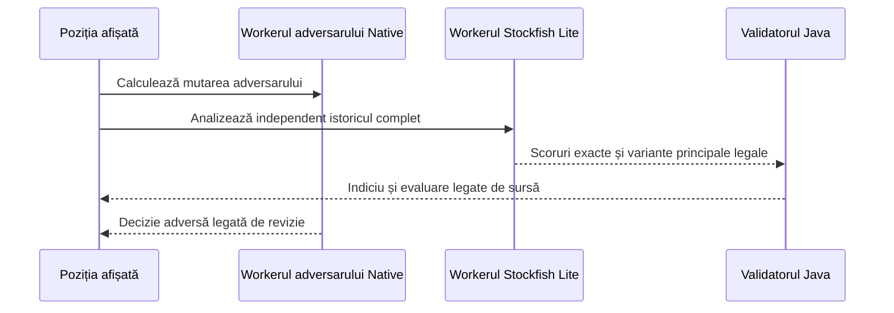

# Analiza Stockfish pe Web și Android

## Migrarea cerută la Lite

Candidatul curent folosește **Stockfish Lite** pentru indicii calculate, bara de evaluare, analiza deschiderilor, tabla de analiză și Analiza partidei. Basic, Advanced și Hard rămân adversari Native independenți. Soluțiile catalogului și referințele memorate ale deschiderilor își păstrează proveniența. [Acceptare și lucrări rămase](../docs/feedback/stockfish-web.md) · [A/B și Elo Native](../docs/testing/hard-ab-elo.md)

## Responsabilități

| Rută | Calcul | Proprietarul stării |
|---|---|---|
| Indiciu și bară în partida AI | Stockfish Lite | Poziția Java selectată și istoricul complet |
| Tabla de analiză | Stockfish Lite | Linia Java de studiu și semnul de carte |
| Analiza calculată a deschiderii | Stockfish Lite | Prefixul exact al lecției |
| Analiza intermediară și finală | Comparații Lite recomandat/jucat | Partida Java înregistrată și dovezile validate ale furnizorului |
| Soluția problemei și teoria redactată | Catalog verificat și redare legală | Catalogul Java comun |
| Mutarea adversarului | Native Basic, Advanced sau Hard | Politica Java comună a partidei |

Bara afișează evaluarea albului pe scara progresivă comună în centipioni. +1 pion ocupă 60%, iar +8 aproximativ 83%; scorurile finite păstrează ambele culori vizibile. WDL observat rămâne neschimbat pentru analiză și clasificare. Scara vizuală nu măsoară Elo sau probabilitatea umană de câștig. Schimbarea nivelului adversarului nu slăbește motorul de analiză și nu schimbă furnizorul.

## Cerere și validare

Legendă — calcul și stare independente

Android folosește executori diferiți pentru adversar, analiza afișată și review. Web are un worker dedicat mutării Native și consumatori independenți de analiză serviți de brokerul Stockfish. O analiză în așteptare sau eșuată nu poate furniza mutarea adversarului sau bloca acel calcul. Schimbarea poziției afișate anulează proprietarul analizei; răspunsurile vechi nu pot suprascrie bara nouă. Componentele blochează analiza în timp ce compară decizia Native efectivă, orizontul și costul.

Fiecare cerere păstrează FEN-ul inițial și prefixul complet, inclusiv culoarea, drepturile, contoarele și repetițiile. Poziționarea egală a pieselor nu dovedește același context. Java validează furnizorul, buildul, opțiunile, adâncimea exactă, identitatea sursei și fiecare mutare PV. Pornirea eșuată sau dovezile incomplete arată indisponibilitatea; nu există fallback de analiză Native.

[StockfishCoaching](../chess-core/src/main/java/ro/atf/chess/StockfishCoaching.java) și [StockfishTransport](../chess-core/src/main/java/ro/atf/chess/StockfishTransport.java) implementează orchestrarea nativă. [AndroidStockfish](../android/app/src/main/java/ro/atf/chess/android/AndroidStockfish.java) verifică motorul și rețeaua împachetate. [Politica Web](src/main/web/stockfish-analysis.mjs) folosește workerul WASM cu pini proprii.

## Scoruri, indicii și review

Ambele platforme cer un fir, Hash 32 MiB, 200.000 de noduri și MultiPV 3, fără limitarea abilității. Nodurile cerute și lucrul observat rămân distincte. Stockfish raportează scorul culorii la mutare; bara îl normalizează la Alb, independent de orientare.

Sunt comparabile doar cohorte MultiPV exacte și complet încheiate. Ultimul lot complet la aceeași adâncime supraviețuiește întreruperii unei iterații mai adânci; rangurile unor adâncimi diferite nu se combină. Oferim cel mult trei linii selectabile: liderul și alternative aflate la maximum 60 cp și 50 de puncte de scor așteptat, ori cu aceeași distanță de mat. Trei linii apropiate rămân vizibile când există. O singură linie corectă nu produce un rând de selectoare goale. Taburile împart un rând, păstrează cursoare independente și nu pornesc altă căutare. Becul conturat are aceeași culoare discretă în Deschideri, AI și Tabla de analiză.

Analiza partidei compară rădăcina liberă cu mutarea efectiv jucată la cea mai mare adâncime comună încheiată. Păstrează întreaga PV observată și identitatea furnizorului. O căutare limitată nu este o dovadă tactică exhaustivă. Nu adăugăm continuări Native fără scor sau evaluări statice de frunză unei PV externe.

Istoricele de deschidere acoperite pentru adversar reutilizează rădăcinile măsurate independent din `opening-reference.yaml`, cel mult trei la maximum 40 cp. Ordinalul persistat al partidei rotește opțiunile eligibile înainte de repetare și restaurează alegerea după restart. Suprascrierile verificate au prioritate; istoricele neacoperite păstrează politica Native de teorie și căutare. Mutarea adversarului nu lansează o căutare de analiză Stockfish.

## Analize salvate

Colectorul incremental Web păstrează observațiile complete recomandat/jucat pe semimutare într-un spațiu Lite separat. FEN-ul inițial, întregul istoric, buildul motorului și opțiunile guvernează reutilizarea. Analiza finală agregă lucrul complet validat; dovezile lipsă, modificate sau străine nu pot fi salvate drept complete. Arhivele Full și Native păstrează furnizorul inițial până la reanalizare explicită.

Android păstrează momentan 64 de intrări RAM ale căutării, până la 64 de recepții UCI de diagnostic și analize finale durabile. Cache-ul RAM nu este un jurnal durabil pe partidă după moartea procesului. Redeschiderea unui review complet și recuperarea lucrului parțial sunt domenii diferite; ultimul rămâne în feedback. Nu prezentăm această limită ca un contract incremental de persistență încheiat.

## Distribuție

Sursa este Stockfish.js 19.0.1 la `0d5dd7944f88c817c07a26bc4fb1905d5f9c46d6`. Loaderul Lite Web are 28.230 de octeți, iar WASM 1.845.971, cu pini independenți din release-ul upstream. [Notificări și manifest](src/main/web/stockfish/README.md) · [Verificator de build](tools/verify-stockfish.mjs)

Android folosește rețeaua compatibilă `nn-61e7af4bb97d.nnue` și buildul `LITE_NET=yes` al aceluiași fork. API 26, PIE și alinierea ELF LOAD la 16 KB sunt verificate pentru `arm64-v8a`, `x86_64` și `armeabi-v7a`. Arhiva sursă nemodificată, notificările GPL, rețeta reproductibilă și patchul nativ declarat `uci.loop()` → `uci->loop()` însoțesc pachetul. [Pachetul nativ](../android/app/src/main/assets/stockfish/README.md) · [Controlul independent al pachetului](../android/stockfish-package.gradle)

Lite are o rețea mai mică; dimensiunea pachetului nu dovedește aceeași forță ca Full sau un Elo Native Hard nou. Încărcarea Web la rece este asincronă, iar calculul local nu cere un serviciu extern. Runtime-urile imuabile deja publicate păstrează octeții pentru taburile vechi.

## Verificare

`ChessWebStockfishTransportTest` importă în Extent valorile originale Node așteptat/observat/verdict. Cu `chess.stockfish.bundle`, execută și WASM-ul fixat prin proiecția Java compilată: indicii, loturi complete de trei linii, deschideri, jurnale, arhive vechi și respingerea unei PV substituite. Acceptarea randării prin Browser MCP rămâne o observație separată. [Strategia de testare](../docs/testing/README.md)

`StockfishCoachingComponentTest`, `AndroidStockfishCoachingTest` și `ExternalEngineAnalysisTest` acoperă istorice exacte, adâncimi comune încheiate, cohorte parțiale/cu limite, anulare, progres independent al adversarului, perspectiva WDL, PV legale, proprietari închiși și arhive negative. `StockfishNativeTransportTest` este o probă host activată separat și nu poate califica executabilul Android.

APK-ul semnat trebuie să pornească motorul împachetat și să păstreze UCI brut, aserțiuni originale și o captură în Extent. Buildul pachetului și componentele cu mock nu sunt PASS pe dispozitiv. Fontul, rotația și redarea dimensionată după sursă păstrează domeniile existente de verificare. [Procedura de release](../docs/release/README.md#calificare-și-publicare) · [Acceptare restantă](../docs/feedback/stockfish-web.md)

TeaVM țintește Java 17 chiar când testele rulează pe Java 21. Guvernanța portabilității respinge metodele colecțiilor disponibile doar din Java 21. Benchmarkurile Native de diagnostic rămân distincte de furnizorul Stockfish al produsului; omiterile rămân explicite, fără a fi numite PASS.