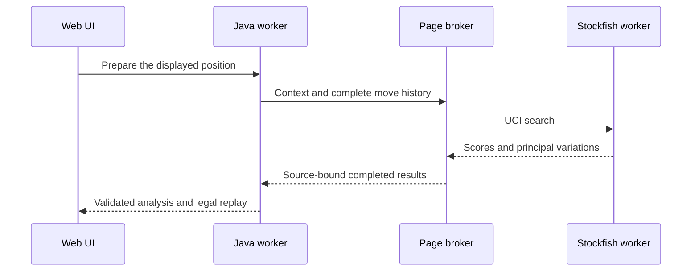

# Stockfish analysis on the Web

## Requested Lite migration

The product requirement is **Stockfish Lite**, including all hints, the evaluation bar, openings, manual analysis and complete Game Review on Web and Android. Full is not the requested next package. The current-source description below remains the baseline until Lite's independent source/build/data pins, components and platform evidence qualify. [Requirements and source handoff](../docs/feedback/stockfish-web.md) · [Native opponent A/B and Elo](../docs/testing/hard-ab-elo.md)

A Windows executable cannot run directly in the browser or APK. Web uses a local WebAssembly worker; Android needs a compatible native build and network. The proposed Lite assets are much smaller, but their size does not prove equivalent strength. Another AI owns the APK/RAG and publication task; this documentation update does not qualify or publish a Lite binary.

## Ownership

The Web adapter uses the full single-thread Stockfish 19 engine for position analysis. Java still owns legal moves, catalogs, saved games and navigation. AI opponents retain their existing Java levels; their difficulty does not weaken the analysis engine.

| Route | Analysis source | State owner |
| --- | --- | --- |
| In-game evaluation and lightbulb | Stockfish | The selected Java match position |
| Manual analysis board | Stockfish | The Java study line and bookmark |
| Opening analysis | Stockfish | The Java opening lesson and selected position |
| New Game Review | Stockfish free and played-move comparisons | The recorded Java game |
| Puzzle solution and opening theory | The verified catalog or authored theory | The shared Java catalog |
| Android hints and review | Existing native engine | The Android adapter and shared core |

## Request and validation

Legend — calculation and state are separate

The page owns one lazy Stockfish client. Replacing a Java consumer cancels that consumer's pending calculations; it does not create another large engine for the next board frame. Java validates the returned position, history identity, source, depths and every PV move before publishing the view.

The UCI position contains the original FEN and the complete move prefix. The displayed board placement alone is insufficient: castling, en passant, clocks and repetition history also matter. A changed revision rejects a delayed result, including a return from A to B and then to the same visible A.

The client serializes searches. Cancellation sends `stop` and drains the old `bestmove` before another position is submitted; a failed engine is closed and reported as unavailable. It does not silently replace a failed Stockfish result with a Hard result.

The initial policy is 200,000 requested nodes and three principal variations. In-game recommendations always retain the best exact line and offer at most two further exact roots when they are close: within 60 centipawns and 50 expected-score points of the best at the same completed depth. The Java projection caps the selectable set at three; weaker observations remain in the raw audit batch but are not presented as equal choices. [Policy and orchestration](src/main/web/stockfish-analysis.mjs) keep the limit separate from opponent difficulty. The returned rows retain their reported work and source options; a requested budget is not the measured cost of one branch.

The TeaVM compiler targets Java 17 even when the Android/JVM test process runs on Java 21. Keep TeaVM-reachable core on the Java 17 library surface; the TeaVM portability governance test guards against SequencedCollection-only calls that can pass JVM tests but fail the shipped Web build.

## Scores, hints and review

Stockfish reports scores for the side to move. The Java projection normalizes the visible evaluation to White and preserves mate values separately from ordinary centipawns. WDL is an engine-model estimate, not a measured human win rate.

Only comparable exact rows from a completed depth are grouped together. A candidate batch is complete only when Stockfish finished the MultiPV iteration and returned every requested rank with an exact score and PV at that depth. If a deeper iteration stops after returning only some ranks, discard that partial batch and keep the latest complete common-depth batch; never combine ranks across depths or replace a full top-three batch with a partial single line. The lightbulb, destination tap and playable line share the accepted result. Large-loss alternatives are not offered as equally good hints, so the visible set can contain fewer than three when no further root meets the closeness thresholds.

For each recorded move, Game Review compares the free recommendation and the played root at their highest common completed depth. The free observation retains the completed top-three MultiPV batch as audit evidence; an interrupted deeper partial batch cannot replace it. Grading and the visible recommended branch use its best line, alongside the played line. The played root has its own constrained search when it differs from the best root. Failure to complete a comparison prevents a partial review from being saved as a completed review.

The native opponent still uses the shared Java move provider on Web and Android. At an exact opening prefix covered by `opening-reference.yaml`, a new game rotates pseudo-randomly among the stored Stockfish 19 roots (up to three, each within 40 cp of the measured leader). The saved per-game ordinal makes a resumed game choose the same move, and every eligible root is visited before a cycle repeats. Verified repertoire overrides remain authoritative. If the played prefix is not covered, the existing curated theory and search behavior applies. This uses measured data; opponent moves do not start a live Stockfish search, and Stockfish does not become the Web opponent. The same policy and YAML are packaged into the APK and Web bundle.

A completed UCI search is bounded engine evidence. It is not labeled as a native Hard tactical certificate or an exhaustive proof. Existing opponent-rating eligibility remains distinct from the identity of the analysis engine; switching the analyzer does not establish a new Elo calibration.

## Saved analyses

Existing native review versions remain readable without automatic recalculation. Their provider remains visible. Reanalysis with Stockfish is explicit, keeps the game identity and played history, and writes the external provider's evidence separately from native proof fields.

Current Stockfish reviews retain the engine build, source commit, options and per-position identity. Opening a saved review does not run the engine again. Navigation and line replay operate on the stored, validated moves.

The incremental collector uses a separate Stockfish storage namespace. It saves each completed pair of free/played observations and resumes after interruption. When a game grows, reuse requires the same initial position, full move prefix, current FEN, played move and engine policy. Java revalidates every reused PV and comparison. A final review supplied with a journal aggregates that evidence without another search; incomplete, modified or foreign evidence fails explicitly. Native journals and archived native reviews keep their original identity.

## Distribution

The pinned engine is Stockfish.js 19.0.1, full single-thread, from source commit `0d5dd7944f88c817c07a26bc4fb1905d5f9c46d6`. The loader and 99,169,054-byte WASM are local assets in the same immutable runtime directory. They load when analysis is requested; there is no remote analysis service.

[Build validation](tools/verify-stockfish.mjs) checks the independently pinned upstream hashes as well as the package manifest, GPL text, authors and corresponding-source notice. [Engine package and notices](src/main/web/stockfish/README.md) · [Upstream source](https://github.com/nmrugg/stockfish.js/tree/0d5dd7944f88c817c07a26bc4fb1905d5f9c46d6)

The packager preserves vendor bytes and adjacent loader/WASM paths. Git attributes keep those bytes unchanged through staging and checkout. The existing publication process preserves earlier runtime directories for open tabs. [Web publication](parity.md#publishing-the-link)

## Verification

Use component tests for parsing, queueing, cancellation, source identity, stale results, common-depth comparison and saved-review compatibility. The new Node fixtures emit original expected/actual assertion rows for ATF reporting; importing those rows does not rerun the underlying assertions or reinterpret predicate assertions as string equality.

Real WASM execution, the compiled Java projection and the rendered browser flow have separate observations. Mock success does not substitute for engine startup or browser behavior. Keep build logs, native receipts, transcripts, captures and Extent in the working evidence directory outside the checkout. [Testing strategy](../docs/testing/README.md) · [Open acceptance](../docs/feedback/stockfish-web.md)

Run `ChessWebStockfishTransportTest` with `-Dchess.stockfish.bundle=<external-site>` and a fresh `-Dchess.extent=<external-report>`. Its component inventory covers UCI parsing, lifecycle, source pins, score display and journals. The opt-in compiled test uses the production Java projection and the actual pinned WASM, then checks hints, openings, journal aggregation, illegal substituted PV rejection and saved-review reopening. Run `ExternalEngineAnalysisTest` for the JVM boundary and codec negatives. The rendered browser check remains a separate scope.

`ChessWebStockfishPlaywrightE2e` publishes the minimal rendered flow through ATF reporting, with actions, assertions and embedded PNGs. Supply the site, browser executable and a fresh `chess.stockfish.browser.extent` path. The test closes its isolated browser profile and leaves ordinary browser sessions alone.

Native numeric expectations remain mandatory in the JVM component `MatchAnalysisParityTest`. The slow compiled Native historical-search comparison is retained as an explicit opt-in benchmark (`chess.web.nativeCompatibility=true`), using the test-only `native-analysis-reference.mjs` adapter. It is not the production Web coaching provider and its skipped status is not a PASS. The real-WASM integration and browser sanity qualify Stockfish instead; archived Native data and the shared rules remain independently checked.

Legacy search subprocesses have a separate bounded execution timeout. It does not change their node budget or numeric expectations and is not a latency acceptance threshold. UCI initialization, search, stop/drain and cancellation retain their own independently tested timeouts.

The manual board uses its intrinsic height. Position, evaluation, hint and history follow it as one compact group; unused viewport height stays outside that group. Hint disclosure reserves its row and cannot shift the square. `ChessWebAnalysisLayoutTest` checks the component contract, while the rendered sanity measures actual gaps and fit at 390 × 844, 360 × 640 and 740 × 420, including 130% text.

Cold engine loading is asynchronous: the manual board renders first and requests its evaluation separately. Errors are shown for retry; another engine is not substituted. The large full-engine download is intentional and remains lazy.

The rendered test waits for first-engine readiness within the transport's existing initialization, ready and search bounds (120 + 10 + 30 seconds). Ordinary UI actions retain their 45-second bound. These are execution limits, not chess-quality or latency acceptance thresholds; a startup failure records visible state, engine responses and a capture before the browser closes.
