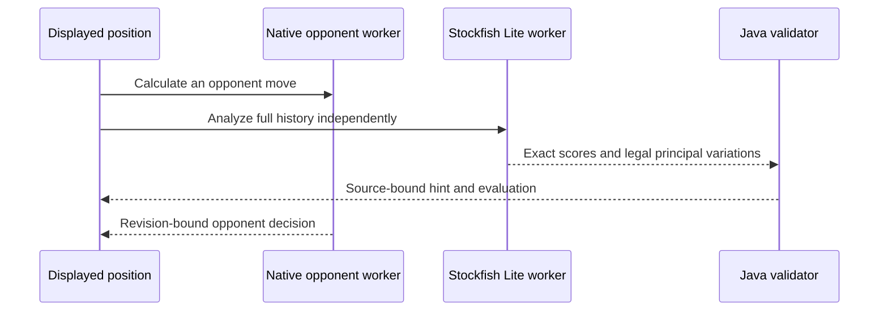

# Stockfish analysis on Web and Android

## Requested Lite migration

The current candidate uses **Stockfish Lite** for calculated hints, the evaluation bar, opening analysis, the manual board and Game Review. Native Basic, Advanced and Hard remain independent opponents. Catalog solutions and stored opening references retain their recorded provenance. [Acceptance and remaining work](../docs/feedback/stockfish-web.md) · [Native A/B and Elo](../docs/testing/hard-ab-elo.md)

## Ownership

| Route | Calculation | State owner |
|---|---|---|
| AI-game hint and evaluation bar | Stockfish Lite | Selected Java match position and complete history |
| Manual analysis board | Stockfish Lite | Java study line and bookmark |
| Calculated opening analysis | Stockfish Lite | Exact opening lesson prefix |
| Interim and final Game Review | Stockfish Lite free/played comparisons | Recorded Java game and validated provider evidence |
| Puzzle solution and authored theory | Verified catalog and legal replay | Shared Java catalog |
| Opponent move | Native Basic, Advanced or Hard | Shared Java match policy |

The bar displays White's engine evaluation on the shared gradual centipawn scale. +1 pawn occupies 60% and +8 about 83%; finite scores leave both colors visible. Observed WDL remains unchanged for review and grading. The visual scale is not an Elo measurement or a measured human win probability. Changing opponent level cannot weaken the coaching engine or select another analysis provider.

## Request and validation

Legend — independent computation and state

Android uses separate executors for the opponent, displayed coaching and review. Web uses a dedicated Native turn worker and independent analysis consumers served by the Stockfish broker. A pending or failed coaching request cannot supply the opponent move or block its calculation. Replacing the displayed position cancels its coaching owner; old replies cannot overwrite the new bar. Components stall the coaching calculation while comparing the actual Native decision, horizon and work.

Every request carries the original FEN and full move prefix, including side, rights, clocks and repetition history. Equal board placement does not establish equal context. Java validates provider/build/options, exact depth, source identity and every PV move. Failed startup or incomplete evidence reports unavailability; there is no Native coaching fallback.

[StockfishCoaching](../chess-core/src/main/java/ro/atf/chess/StockfishCoaching.java) and [StockfishTransport](../chess-core/src/main/java/ro/atf/chess/StockfishTransport.java) implement native orchestration. [AndroidStockfish](../android/app/src/main/java/ro/atf/chess/android/AndroidStockfish.java) verifies the packaged engine and network. Web's [policy](src/main/web/stockfish-analysis.mjs) uses the separately pinned WASM worker.

## Scores, hints and review

Both platforms request one thread, 32 MiB hash, 200,000 nodes and MultiPV 3 without skill limiting. Requested nodes and observed work remain distinct. Stockfish reports the side-to-move score; the displayed bar normalizes it to White, independently of orientation.

Only fully completed exact MultiPV cohorts are comparable. The latest complete common-depth batch survives an interrupted deeper iteration; ranks from different depths are never combined. Offer at most three selectable lines: always the leader, plus alternatives within 60 cp and 50 expected-score points, or with the same mate distance. Three close lines remain visible when available. A sole sound line has no empty selector row. Tabs share one row, preserve independent replay cursors and do not run another search. The outline bulb uses the same muted color across Openings, AI and the Analysis board.

Game Review compares the free root with the actual played root at their highest common completed depth. It retains the complete observed PV and provider identity. A bounded search is not an exhaustive tactical proof. No unscored Native continuation or static leaf score is appended to an external PV.

Covered opponent opening histories reuse the independently measured roots from `opening-reference.yaml`, up to three within 40 cp. The persisted per-game ordinal rotates eligible choices before repetition and restores the same choice after restart. Verified repertoire overrides remain first; uncovered histories keep their existing Native theory/search policy. Opponent turns do not launch a Stockfish coaching search.

## Saved analyses

The Web incremental collector stores complete per-ply free/played observations in the Lite-specific namespace. Exact initial FEN, full history, engine build and options govern reuse. Final review aggregates validated complete work; missing, modified or foreign evidence cannot be saved as complete. Old Full and Native archives keep their original provider until explicit reanalysis.

Android currently retains a 64-entry RAM search cache, up to 64 diagnostic UCI receipts and durable completed reviews. The RAM cache is not a durable per-game work journal after process death. Completed-review reopening and partial-work recovery are different acceptance scopes; the latter remains in feedback. This limitation must not be represented as a completed incremental-persistence contract.

## Distribution

The source is Stockfish.js 19.0.1 at `0d5dd7944f88c817c07a26bc4fb1905d5f9c46d6`. The Lite Web loader is 28,230 bytes and WASM is 1,845,971 bytes, independently pinned to the upstream release. [Vendor notices and manifest](src/main/web/stockfish/README.md) · [Build verifier](tools/verify-stockfish.mjs)

Android uses the compatible `nn-61e7af4bb97d.nnue` network and the same fork's `LITE_NET=yes` build. API 26, PIE and 16 KB ELF LOAD alignment are checked for `arm64-v8a`, `x86_64` and `armeabi-v7a`. The unmodified source archive, GPL notices, reproducible recipe and disclosed native-only `uci.loop()` → `uci->loop()` patch accompany the package. [Native package](../android/app/src/main/assets/stockfish/README.md) · [Independent package guard](../android/stockfish-package.gradle)

Lite has a smaller network; package size establishes neither equivalent Full strength nor a new Native Hard Elo. Cold Web loading is asynchronous and local computation needs no remote analysis service. Previously published immutable runtimes retain their bytes for older open tabs.

## Verification

`ChessWebStockfishTransportTest` imports the original Node expected/actual/verdict rows into Extent. With `chess.stockfish.bundle`, it also executes the real pinned WASM through the compiled Java projection: hints, complete top-three batches, openings, journals, old archives and substituted-PV rejection. Rendered Browser MCP acceptance remains a separate observation. [Test strategy](../docs/testing/README.md)

`StockfishCoachingComponentTest`, `AndroidStockfishCoachingTest` and `ExternalEngineAnalysisTest` cover exact histories, common completed depths, partial/bounded cohorts, cancellation, independent opponent progress, WDL perspective, legal PVs, closed owners and archive negatives. `StockfishNativeTransportTest` is a separately enabled host-process probe and cannot qualify an Android executable.

The signed APK must start its packaged engine and retain raw UCI, original assertions and a capture in Extent. Package/build success and mocked components are not a device PASS. Font, rotation and source-sized replay retain their existing component and platform scopes. [Release procedure](../docs/release/README.md#qualification-and-publication) · [Unmet acceptance](../docs/feedback/stockfish-web.md)

TeaVM targets Java 17 even when tests run on Java 21. The portability guard rejects Java 21-only collection methods. Keep native diagnostic benchmarks separate from the production Stockfish provider, and retain explicit skips rather than calling them PASS.